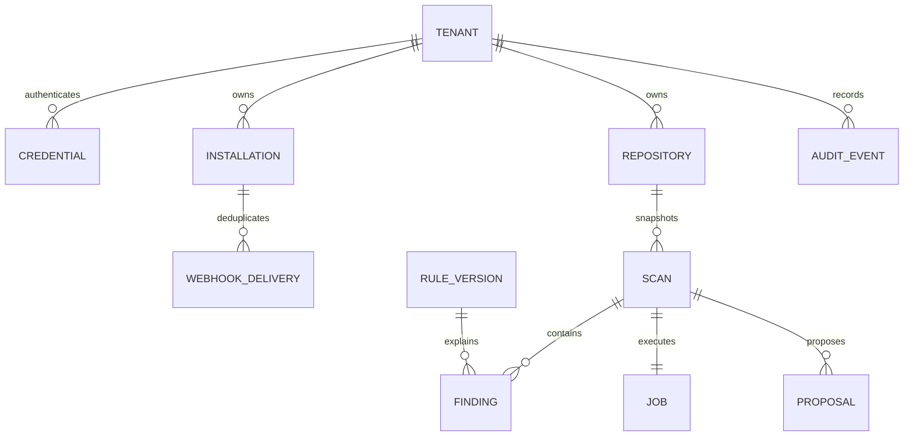
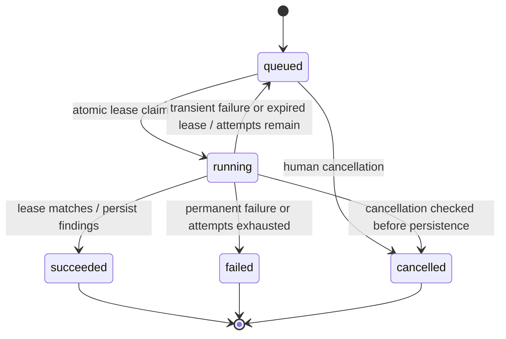

# RepoGuard architecture

Contract version 1. Modular monolith, separate API/worker processes and Next.js frontend. PostgreSQL is authoritative; Redis wakes workers but never owns the only copy of a job. All source and configuration are hostile data. Analysis reads bounded text; executing tests requires a separate isolated validator service. No Docker socket is mounted into the API or scan worker.

```mermaid
flowchart LR
    Human[Authenticated human] --> UI[Next.js dashboard]
    UI --> API[FastAPI tenant boundary]
    GitHub[GitHub App / signed events] --> API
    API --> DB[(PostgreSQL durable records)]
    API --> Redis[(Redis wakeups)]
    Redis --> Worker[Scan worker]
    Worker --> DB
    Worker --> Archive[Bounded immutable snapshot]
    Archive --> Scanner[Versioned static rules]
    Scanner --> Score[Versioned score / coverage]
    Score --> DB
    DB --> Proposal[Deterministic patch policy]
    Proposal --> Validator[Dedicated container validator]
    Validator --> DB
    Human --> Approval[Exact digest approval]
    Approval --> PR[GitHub branch / PR adapter]
    PR --> GitHub
```

## Identity and tenancy
An operator provisions random opaque bearer tokens, stores SHA-256 hashes and maps each identity to a tenant. Tokens have 256 bits of entropy; tenant IDs from requests are never trusted. Installation IDs are assigned to tenants by an operator after independent installation ownership verification. No self-claim installation endpoint exists. Every repository/scan/job/finding/proposal query scopes by authenticated tenant. Cross-tenant identifiers return 404, unauthenticated access 401. Production requires TLS at ingress. Token rotation/revocation use operator CLI. This is a bounded MVP auth design; a public SaaS needs an OIDC session and role layer before deployment.

## Data model
UUID string primary keys except versioned rule IDs and webhook delivery UUIDs. UTC timestamps. Foreign keys, unique constraints and indexes enforce identity and retry guarantees. Large source archives are ephemeral; retained evidence is bounded/redacted. JSON findings and score documents are immutable artifacts associated with a scan, not a source download API.

Repositories store validated owner/name, provider ID, installation ID and fixture identity. Scans store full SHA, engine/rule/policy versions, score/coverage, request idempotency key and lifecycle. Jobs store state, attempts/max attempts, lease token/expiry, cancellation and sanitized error codes. Proposals store exact base SHA, patch digest, provenance, validation status, human approval identity/time and remote branch/PR identity. Audit events record actor/action/entity/correlation but no secrets/source. Webhook delivery insertion and event job enqueue share a transaction.

## APIs
See docs/API.md for concrete endpoints. Errors use standard HTTP status and safe messages. Request bodies forbid extra fields; identifiers and lengths are bounded. Authenticated API does not accept arbitrary source URLs, paths or commands. Fixture IDs resolve through a fixed trusted mapping. Real repositories require verified installation discovery. Request idempotency conflicts reject different payloads under the same key. `/health/live` reveals no secrets; dependency readiness distinguishes degraded availability.

## Ingestion and lifecycle
GitHub archive endpoints are generated from validated owner/name/full SHA. Only HTTPS GitHub/codeload hosts are permitted during redirects, token stripped at redirect boundary. Download timeout, compressed/expanded/file/path limits apply. ZIP extraction rejects absolute/drive/backslash/dot-dot/control paths, symlinks, special files, duplicate/case-colliding names, excessive ratios/counts/depth and compression failures. No archive members are executed. Symlink-free directories are created in private ephemeral storage. Snapshot base SHA must be rechecked before PR creation.

Use PostgreSQL atomic conditional UPDATE/row locking for claims; lease identity fences late completion after a worker restart. Recovery polls due rows even if Redis fails. Fixed bounded retry backoff and maximum attempts. Worker isolates parser subprocesses for memory/time limits in deployment; source never executes. Cancellation is cooperative between bounded phases and prevents result publication; it cannot undo already authorized remote mutations.

## Analysis and scoring
Initial supported inputs: Python static Semgrep rules, requirements pins, Dockerfile and GitHub Actions/YAML/JSON configuration checks. Tree-sitter is deferred until a rule needs syntax coverage unavailable through Semgrep/config parsing. No dependency vulnerability database claims. Unknown languages, missing engines, skipped oversized/binary inputs and parse failures reduce coverage. Versioned categories sum to 100; unscanned categories earn zero and display unknown. Scanned categories lose severity-based points for deduplicated rule/location findings, floor zero. Score describes supported controls only, never certifies overall production safety. Canonical sorted findings plus policy/rule versions yield a reproducibility digest. Detailed policy in G06.

## Threat model and boundaries

| Threat / hostile actor | Enforced control | Evidence required |
| --- | --- | --- |
| Archive traversal, symlink, bomb, duplicate | strict names/type/size/count/depth/ratio bounds; ephemeral extraction | adversarial unit corpus |
| Cross-tenant enumeration or mutation | server-derived tenant on every query; trusted installation provisioning | negative API tests |
| Forged/replayed webhook | raw HMAC constant-time verification; persisted delivery dedupe; bounded body | signature/replay/transaction tests |
| Stolen credentials/source in logs | hashed bearer tokens; SecretStr config; allowlisted logs, redacted findings | secret leakage tests |
| Hostile manifest or code | never install dependencies/import/run source on host | command policy and sandbox tests |
| Parser/scanner hangs | input bounds, analysis deadline, fixed argv, bounded output; dedicated worker CPU/memory | timeout/bomb tests |
| Prompt injection / model patch | model disabled by default; bounded typed proposal only; deterministic path/rule/digest policy | hostile repository fixture tests |
| Unauthorized/stale PR | authenticated explicit digest approval; validated patch; recheck SHA; dedicated branch; no merge | approval/stale/retry tests |
| Worker crash / duplicate events | durable jobs/delivery IDs; conditional claims and fenced leases; retry limit | concurrency/service tests |
| Fork/untrusted PR event | ignore source-executing workflows and PR event jobs; immutable signed push only | event policy tests |
| Sandbox escape / resource abuse | dedicated hosts; nonroot/no caps/network/read-only root/no sensitive mounts; CPU/memory/PID/deadline | Docker adversarial tests; remaining kernel risk |

Container isolation shares the kernel and does not eliminate escapes. Production should use dedicated disposable workers, preferably VM/microVM isolation, separate from DB/API credentials. No API request may configure the sandbox image, mounts, network or command. Until a container test passes, validation reports unavailable and PR eligibility fails closed.

## Primary references
- [GitHub installation tokens](https://docs.github.com/en/apps/creating-github-apps/authenticating-with-a-github-app/generating-an-installation-access-token-for-a-github-app): installation tokens scoped to repositories/permissions, limited lifetime.
- [Webhook validation](https://docs.github.com/en/webhooks/using-webhooks/validating-webhook-deliveries): validate raw body with HMAC-SHA256.
- [Docker resource constraints](https://docs.docker.com/engine/containers/resource_constraints/) and [security](https://docs.docker.com/engine/security/): explicit limits and daemon trust boundary.
